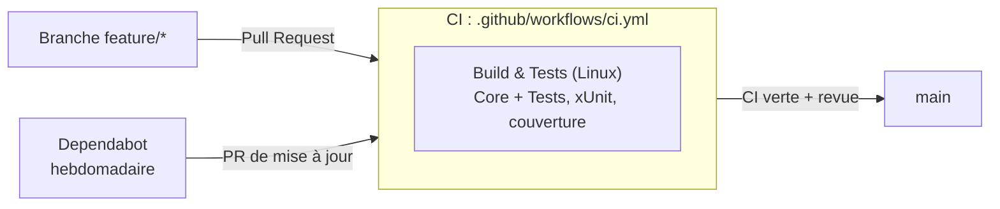

# Démarche DevOps : TcoCalculator

Ce document décrit la chaîne d'intégration et de livraison du Simulateur TCO / CO2.
Il est complété à chaque étape du projet.

## Vue d'ensemble du pipeline

Étapes prévues (à venir) : analyse SonarCloud, build de l'UI sur Windows, release Velopack sur tag.

## Organisation du dépôt

| Projet | Cible | Dépendances |
|---|---|---|
| `TcoCalculator.Core` | `net9.0` | aucune |
| `TcoCalculator.Data` | `net9.0` | Core |
| `TcoCalculator.UI` | MAUI, Windows | Core, Data |
| `tests/TcoCalculator.Tests` | `net9.0` | Core (Data plus tard), jamais UI |

Workflow Git : une étape = une branche `feature/<sujet>` = une PR vers `main`.
Commits au format Conventional Commits (`chore:`, `ci:`, `test:`, `feat:`, `docs:`).

## Socle qualité

| Fichier | Rôle |
|---|---|
| `global.json` | Épingle le SDK .NET sur la bande 9.0.3xx (`rollForward: latestPatch`) : même compilateur en local et en CI, même si un SDK .NET 10 est présent sur la machine. |
| `Directory.Build.props` | Paramètres communs à tous les projets : `Nullable`, `ImplicitUsings`, `TreatWarningsAsErrors`, `AnalysisLevel=latest-recommended`, `EnforceCodeStyleInBuild`. |
| `.editorconfig` | Conventions de formatage et de style (UTF-8, indentation, namespaces file-scoped, nommage). Les règles en `warning` sont vérifiées à la compilation. |
| `.github/dependabot.yml` | Mises à jour hebdomadaires des paquets NuGet (tous les projets) et des actions GitHub ; les paquets `Microsoft.*` sont groupés dans une seule PR. |

Exception : `TcoCalculator.UI` désactive `TreatWarningsAsErrors`, car le code généré par le
template MAUI (namespaces en bloc, `AppDelegate` iOS/Mac) déclenche des avertissements
d'analyse. Ils restent visibles, mais la rigueur stricte s'applique à Core, Data et Tests,
qui contiennent la logique métier.

## Intégration continue

Job `Build & Tests (Linux)` (ubuntu-latest), sur chaque PR et push vers `main` :
restore, build Release, tests xUnit avec couverture (format Cobertura), publication du
rapport de couverture en artefact.

## Limites connues

- Le job Linux ne compile pas `TcoCalculator.UI` (MAUI Windows non compilable sous Linux).
- Dependabot ne met pas à jour `Microsoft.Maui.Controls`, dont la version vient de la
  propriété `$(MauiVersion)` du workload MAUI.
